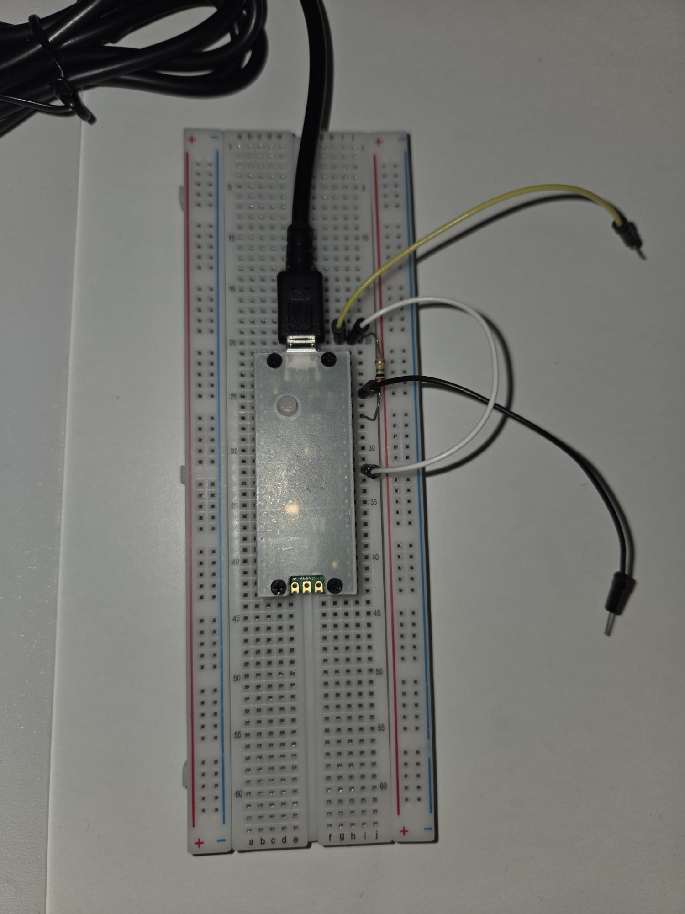

# Hardware

TouchSynth measures the electrical conductance of skin-to-skin contact between
two people. The circuit is a voltage divider: a pull-up resistor from 3.3 V to
an ADC pin, and the two players (through their electrodes) from that pin to
ground. The firmware converts the ADC reading into the conductance of the skin
path, in microsiemens (µS).

## Bill of materials

| Part | Value | Note |
|---|---|---|
| Raspberry Pi Pico 2 | RP2350, CircuitPython 10 | |
| R1 (pull-up) | **1 MΩ** | 470 kΩ – 2.2 MΩ also work; see [Choosing R1](#choosing-r1-with-a-multimeter) |
| R2 (series) | 100 kΩ, **optional** | ESD protection; if fitted set `R_SERIES = 100_000` in `firmware/code.py` |
| C1 | 10 nF (`103`), **optional** | steadies the ADC node; not required (the resting baseline is subtracted) |
| 2 electrodes | metal plates/tubes, copper tape, wristbands | larger and gripped with the whole hand is better |
| Wires, breadboard | | |

## Wiring

```
3V3(OUT) pin 36 ──[ R1 1 MΩ ]──┬── GP26/ADC0 pin 31
                               ├──[ C1 10 nF, optional ]── AGND pin 33
                               └──[ R2 100 kΩ, optional ]── electrode A  (person A)

GND pin 38 ────────────────────────────────────── electrode B  (person B)
```

Connect nothing else to GP26 (in particular, no `DigitalInOut` on that pin).

### Counting breadboard rows

With the USB connector at the top, use the Pico's right-hand column of pins. If
the first pin next to the USB connector (VBUS, pin 40) sits on row N:

| Row | Pin | Use |
|---|---|---|
| N | VBUS (5 V) | **leave unconnected** |
| N+2 | GND (pin 38) | electrode B |
| N+3 | 3V3_EN | **leave unconnected** (pulling it low switches the board off) |
| N+4 | 3V3(OUT) (pin 36) | R1 |
| N+7 | AGND (pin 33) | C1 (optional) |
| N+9 | GP26/ADC0 (pin 31) | R1, C1, electrode A |



*Reference breadboard build (`docs/breadboard_setup.jpeg`).*

## Electrodes

- Each player **grips their electrode with the whole hand** (or wears it as a
  wristband). The grip contact is then low and steady, and what changes is the
  contact *between* the players — which is what the instrument should hear.
- Larger electrodes give a larger and steadier signal. Metal tubes, plates or
  copper tape around a handle all work; bare jumper pins work for testing but
  produce short contact glitches, which the software ignores (< 150 ms).
- Slightly damp hands increase conductance; the adaptive sensitivity (below)
  absorbs the difference.

## Safety

- The current through the players is limited by R1: at most 3.3 V / 1 MΩ
  ≈ **3 µA**, below the **10 µA** patient-leakage limit IEC 60601-1 sets for
  applied parts of medical equipment under normal conditions. Fitting R2 adds
  further series resistance.
- Power the Pico from a laptop on battery or a good-quality USB supply.
- Do not use the instrument with implanted medical devices.

## Wiring check

`tools/wiring_check.py` compares GP26 (the sensor node) with GP27 (left
unconnected). Copy it to the board as `CIRCUITPY/code.py` and open the serial
console (e.g. `screen /dev/ttyACM0`):

- Untouched, **GP26 must read ≈ 3.3 V** (pulled up through R1).
- Touching the electrodes pulls GP26 down.
- If GP26 reads the same as the floating GP27 (~0.76 V), GP26 is not connected
  to R1: recount the breadboard rows.

An unconnected ADC pin does not read 0 V: on this board it floats at about
0.76 V (measured), which is why the check compares against a known-floating pin
rather than against zero.
`tools/diag_code.py` additionally prints the GP26 pad-control register bits
for deeper diagnosis. Redeploy the firmware afterwards (`tools/deploy.sh`).

## Choosing R1 with a multimeter

The divider is most sensitive, on a logarithmic scale, when R1 sits in the
geometric middle of the resistances it has to measure. Each player holds one
multimeter probe (Ω range) and they touch: note the reading for a light touch
(`R_light`) and for a firm palm (`R_firm`). The best R1 is

```
R1 = √(R_light · R_firm)
```

If it is far from 1 MΩ, fit the nearest standard value and set `R_PULLUP` in
`firmware/code.py` to match.

## Adaptive sensitivity

Skin conductance is not a fixed property of a player. It changes several-fold
with time of day, temperature and moisture: on the same setup the median
touch conductance was measured at **0.35 µS in the evening** and **0.07 µS at
night**, a ~5× difference. A fixed scale would make one of those sessions
either saturate or barely move. The firmware therefore adapts in three ways
(`firmware/lib/touchcore.py`):

1. **Resting baseline.** Boot the Pico **without touching the electrodes**: the
   first reading seeds the resting conductance (the ADC's own sampling load,
   ~0.07 µS on the reference board), which is then subtracted. It keeps
   tracking slow drift while nobody touches.
2. **Touch thresholds with hysteresis.** A touch starts above **0.02 µS**
   (50 MΩ) and ends below **0.012 µS** (83 MΩ), one window to start and two to
   end. Resting noise is around 0.003 µS.
3. **Adaptive top.** Intensity is the logarithm of the skin conductance between
   0.012 µS (intensity 0) and a "firm contact" top (intensity 1). After each
   touch, its peak is remembered; the top moves 30 % of the way (on a log
   scale) towards **2.2 × the 75th percentile of the last 12 touch peaks**,
   bounded to 0.06–20 µS. Each touch counts once, so a long steady hold cannot
   saturate the scale, and a few unusually firm touches do not dominate it.

On a night session this raised the number of detected touches from 30 to 48
and the median intensity from 0.30 to about 0.7 (see
[validation.md](validation.md)).

### When to change the constants in `firmware/code.py`

| Constant | Default | Change it when |
|---|---|---|
| `G_MAX_US` | 0.8 µS | It is only the **starting** top before the first touches adapt it. Raise it (e.g. to a few µS) for large electrodes or full-palm contact, so the first touches of a session are not all at 1.0. |
| `R_SERIES` | 0 | You fit the optional R2: set it to `100_000` so its resistance is removed from the skin estimate. |
| `R_PULLUP` | 1 000 000 | You fit a different R1 (e.g. 470 kΩ or 2.2 MΩ). |

## Flashing and deploying

1. **CircuitPython** (first time only): download the UF2 for the
   [Raspberry Pi Pico 2](https://circuitpython.org/board/raspberry_pi_pico2/),
   hold **BOOTSEL** while plugging the board in, and copy the file onto the
   `RP2350` drive. The board reboots as `CIRCUITPY`.
2. **Firmware**: run `tools/deploy.sh` (it auto-detects the mounted `CIRCUITPY`
   drive, or takes its path as an argument). Manually: copy
   `firmware/lib/touchcore.py` to `CIRCUITPY/lib/` and `firmware/code.py` to
   `CIRCUITPY/code.py`.
3. The Pico restarts by itself. The LED lights while there is contact. Raw
   readings can be inspected with `screen /dev/ttyACM0`.

## Troubleshooting

| Symptom | Likely cause and fix |
|---|---|
| Never detects contact | Check the GND connection of electrode B and that each player grips their electrode firmly; try slightly damp hands or R1 = 2.2 MΩ. Run the [wiring check](#wiring-check). |
| Always "TOUCH" | Something shorts GP26 to GND, or R1 is too small. |
| Intensity stuck near 1 or never above ~0.5 at the start of a session | The starting top `G_MAX_US` is far from this setup; it adapts within a few touches, or set it closer to a typical firm contact (the meter's `G=… uS`). |
| Stuck on "waiting for the Pico..." | Check that `/dev/ttyACM0` exists, pass `--port`, and add your user to the `uucp` (Arch) / `dialout` (Debian) group. Close any `screen` session on the port. |
| Crackles | Close other audio applications; the output buffer is `OUTPUT_LATENCY_S` in `touchsynth/app.py`. |
